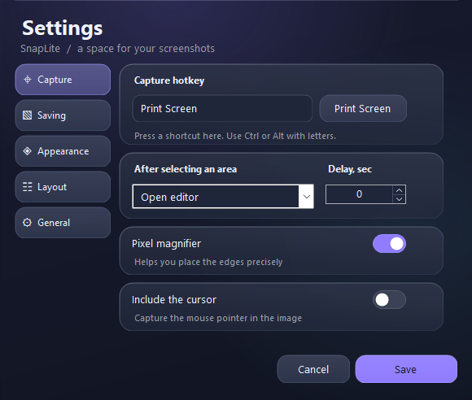
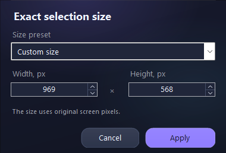

# SnapLite

A lightweight Windows screenshot app that lives in the system tray. Capture an area, add annotations, and copy or save locally.

[Русская инструкция](README.md) · [Download the latest release](https://github.com/makintosh1337/SnapLite/releases/latest)



## Start

Download `SnapLite-v1.2.0.zip`, extract it, and run `SnapLite.exe`. No installation or administrator rights are required. Windows 10/11 with .NET Framework 4.8 is supported.

If the tray icon is hidden, open the **↑** next to the clock. Left-click the icon to capture; right-click to open settings or exit. Closing settings keeps the app in the tray.

## Switch languages

Open **Settings → General → Interface language**. Choose **English** or **Русский**, then **Save**. The preview changes immediately; saving updates the tray and open editors and remembers the language. Cancel restores the previous choice.

In the Russian interface: **Настройки → Общие → Язык интерфейса → English → Сохранить**.

## Capture and enter an exact size

Press **Print Screen** or left-click the tray icon, then drag to select an area. Drag its edges to resize or its interior to move it.

Click the dimension badge, such as **969 × 568 px**, or press **F2**. Choose a size preset or enter your own **Width** and **Height**. Apply changes the selected area in original screen pixels. Near a desktop edge, the area moves inward to keep the requested size. Cancel preserves the previous selection.



| Action | Shortcut |
| --- | --- |
| Square selection while dragging | Shift |
| Move by 1 / 10 pixels | Arrow keys / Shift+arrow keys |
| Adjust width or height | Ctrl+arrow keys |
| Select the whole virtual desktop | Ctrl+A |
| Exact dimensions | F2 or click the size badge |
| Default action | Enter |
| Copy | Ctrl+C |
| Quick save to the configured folder | Ctrl+S |
| Cancel capture | Esc or right-click |

If Print Screen is unavailable, check the assigned hotkey in Settings. Startup fallback shortcuts are Ctrl+Shift+S and Ctrl+Alt+F8.

## Edit and customize

The editor has pen, arrow, rectangle, marker, text, solid cover, undo and redo. **Ctrl+Z / Ctrl+Y** undo and redo, **Ctrl+C** copies, **Ctrl+S** opens Save As, and **Ctrl+Shift+S** saves to your folder.

View zoom and export scale are separate. Output scale ranges from 10% to 400%; 100% keeps original pixels. PNG and JPG are supported, with configurable JPG quality.

In **Appearance**, choose one of five themes or customize eight colors, glass density and corner radius. In **Layout**, dock tools to any edge, align actions, move the selection toolbar above or below the area, reorder controls, or hide labels. Saving updates open editors while preserving their images and annotations.

## Build and test

Run PowerShell in the repository folder:

```powershell
.\build.ps1
```

The executable is written to `dist\SnapLite.exe`. The build uses the system .NET Framework compiler and has no external packages.

```powershell
$report = Join-Path $PWD 'test-results\report.txt'
New-Item -ItemType Directory -Path (Split-Path $report) -Force | Out-Null
$test = Start-Process -FilePath '.\dist\SnapLite.exe' `
    -ArgumentList @('--self-test', ('"{0}"' -f $report)) -Wait -PassThru
Get-Content -LiteralPath $report
if ($test.ExitCode -ne 0) { throw 'Self-tests failed' }
```

Capture tests require an interactive Windows desktop. Tests cover language persistence and switching, exact dimensions near screen edges, settings migration, image formats, resizing, annotations, undo and real desktop capture.

## Storage and resource use

Settings are stored in `%LocalAppData%\SnapLite\settings.xml`; screenshots default to `Pictures\SnapLite`. The app has no network code or animation timers. Protected video and secure desktops may not be capturable. Export is limited to 80 million pixels.

To update, exit the previous version from its tray menu and replace the executable. Screenshots and the settings profile remain. Enable startup only after moving the EXE to a permanent folder.
