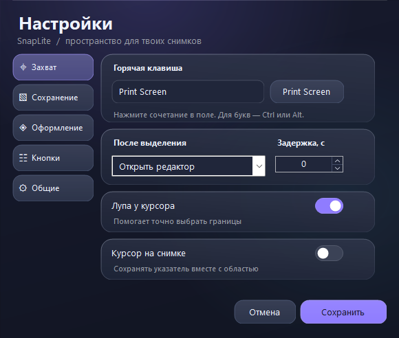
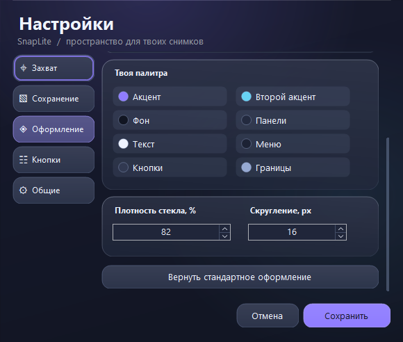

# SnapLite

Лёгкое приложение для локальных скриншотов Windows 10/11. Работает в трее, захватывает выбранную область по горячей клавише и позволяет копировать, сохранять и редактировать снимки.



## Скачать

Готовая программа находится в [Releases](https://github.com/makintosh1337/SnapLite/releases/latest). Скачайте `SnapLite-v1.1.0.zip`, распакуйте и запустите `SnapLite.exe`. Установка и права администратора не требуются.

Нужен .NET Framework 4.8. Интерфейс на русском языке.

## Возможности

- Значок в трее и настраиваемая глобальная горячая клавиша.
- Произвольная область, изменение размера и перемещение выделения, несколько мониторов.
- Лупа для точного выбора пикселей и отображение размеров области.
- Захват экрана под курсором целиком.
- Копирование в буфер обмена, сохранение PNG/JPG, качество JPG.
- Масштаб результата от 10 до 400%, отдельно от масштаба просмотра.
- Редактор: перо, стрелка, рамка, маркер, текст, сплошная заливка, отмена и возврат действий.
- Задержка 0–10 секунд, курсор на снимке, уведомления и автозапуск.
- Интерфейс в стиле liquid glass: градиенты, мягкие блики и стеклянные панели без постоянной анимации.
- Компактное окно настроек 580×492 при 100% DPI, пять готовых тем и своя палитра из восьми цветов.
- Настраиваемые стороны панелей, порядок инструментов и кнопок, плотность стекла и скругление.

В ожидании программа не опрашивает экран и клавиатуру по таймеру: горячая клавиша работает через Windows `RegisterHotKey`. Память для полного изображения рабочего стола освобождается после выбора области. Открытые редакторы хранят свои фрагменты до закрытия.

Снимки хранятся локально. В приложении нет сетевого кода.

## Использование

1. Запустите приложение. Если значок скрыт, откройте стрелку **↑** возле часов.
2. Нажмите **Print Screen** или левую кнопку по значку и выделите область.
3. Выберите действие на панели под выделением: редактор, копирование или сохранение в папку.
4. Для настроек нажмите правую кнопку по значку → **Настройки**.

При первом запуске откроются настройки. Их закрытие оставляет приложение в трее. Для полного завершения выберите **Выход** в меню трея. Повторный запуск EXE открывает настройки работающего экземпляра.

Если стандартная клавиша занята, приложение пробует **Ctrl+Shift+S**, затем **Ctrl+Alt+F8**. Проверьте назначение в настройках.

### Выделение области

| Действие | Клавиши / мышь |
| --- | --- |
| Изменить размер | Потянуть за границы или углы |
| Переместить область | Потянуть внутри выделения |
| Выделить квадрат | Shift при первоначальном выделении |
| Сдвинуть на 1 / 10 пикселей | Стрелки / Shift+стрелки |
| Изменить ширину или высоту | Ctrl+стрелки |
| Выделить весь виртуальный рабочий стол | Ctrl+A |
| Выполнить действие из настроек | Enter |
| Скопировать | Ctrl+C |
| Сохранить в папку | Ctrl+S |
| Отменить захват | Esc или правая кнопка мыши |

Во время задержки повторное нажатие горячей клавиши отменяет захват.

### Редактор

**Ctrl+Z / Ctrl+Y** — отменить / вернуть, **Ctrl+C** — копировать, **Ctrl+S** — сохранить как, **Ctrl+Shift+S** — сохранить в папку из настроек. **Esc** закрывает редактор.

Меню **По окну / 100% / …** меняет просмотр. Поле **В файл: … %** задаёт размер результата при копировании и сохранении. Увеличение масштаба не восстанавливает детали, отсутствующие в исходном снимке.

### Оформление и расположение

В настройках откройте **Оформление**. Доступны темы Midnight, Aurora, Pearl, Rose и Graphite. Каждый цвет меняется отдельно: акцент, второй акцент, фон, панели, текст, меню, кнопки и границы. Введите HEX-код `#RRGGBB` или выберите оттенок в палитре. Предпросмотр показывает изменения сразу; правый клик по нему открывает пример меню. Плотность стекла меняет смешивание панелей с фоном, скругление — форму элементов. Это статичная отрисовка в стиле стекла; размытие рабочего стола не используется.



В разделе **Кнопки** выберите сторону панели инструментов (сверху, снизу, слева, справа), сторону действий и положение панели выделения. Порядок инструментов и действий меняется кнопками ↑ / ↓. Подписи инструментов можно выключить. Изменения применяются к открытым редакторам после **Сохранить**, при этом изображение и правки сохраняются.

Для длинных разделов используйте колесо мыши, тонкую полосу прокрутки или Page Up / Page Down. **Отмена** возвращает прежнее оформление. Сброс оформления и расположения не меняет параметры захвата и сохранения. Старые настройки версии 1.0 загружаются автоматически.

## Сборка из исходников

Понадобятся Windows и системный компилятор .NET Framework. Внешних пакетов и NuGet-зависимостей нет.

Откройте PowerShell в корне репозитория:

```powershell
.\build.ps1
```

Готовый файл: `dist\SnapLite.exe`.

Другую папку можно указать параметром:

```powershell
.\build.ps1 -Destination 'C:\Build\SnapLite'
```

### Проверки

Автоматические проверки охватывают геометрию выделения, настройки, горячие клавиши, размеры результата, PNG/JPG, пометки, отмену и реальный захват экрана. Для проверок захвата нужна обычная интерактивная сессия Windows.

```powershell
$report = Join-Path $PWD 'test-results\report.txt'
New-Item -ItemType Directory -Path (Split-Path $report) -Force | Out-Null
$test = Start-Process -FilePath '.\dist\SnapLite.exe' `
    -ArgumentList @('--self-test', ('"{0}"' -f $report)) -Wait -PassThru
Get-Content -LiteralPath $report
if ($test.ExitCode -ne 0) { throw 'Self-tests failed' }
```

Тестовые изображения и настройки создаются рядом с отчётом. Реальный снимок тестового фрагмента экрана в файлы не сохраняется.

## Файлы проекта

| Файл | Назначение |
| --- | --- |
| `Program.cs` | Запуск, трей, горячая клавиша, маршрутизация захвата |
| `SelectionForm.cs` | Выделение области, лупа, панель действий |
| `EditorForm.cs` | Редактор и экспорт |
| `SettingsForm.cs` | Окно настроек |
| `SettingsAppearance.cs` | Палитра, предпросмотр, порядок кнопок и прокрутка |
| `GlassUI.cs` | Стеклянные панели, элементы управления и отрисовка меню |
| `Core.cs` | Настройки, изображения, пометки и Windows API |
| `Tests.cs` | Встроенные проверки и демонстрационное изображение |
| `build.ps1` | Сборка системным компилятором |
| `app.manifest` | Права запуска и поддержка DPI |

## Настройки и ограничения

- Настройки: `%LocalAppData%\SnapLite\settings.xml`.
- Папка снимков по умолчанию: `Изображения\SnapLite`.
- Автозапуск выключен по умолчанию. Включайте его после переноса EXE в постоянную папку.
- Защищённое видео и защищённый системный рабочий стол могут не захватываться.
- Для ограничения расхода памяти экспорт ограничен 80 млн пикселей.
- Перед удалением выключите автозапуск и завершите приложение через трей. Снимки и настройки сохранятся.
